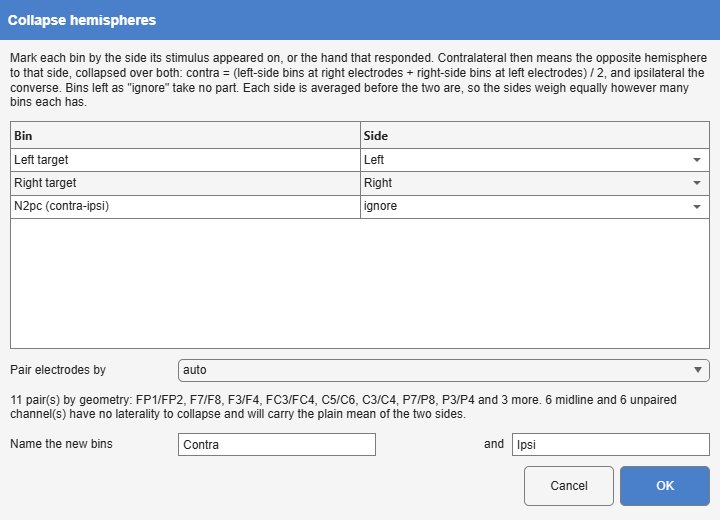
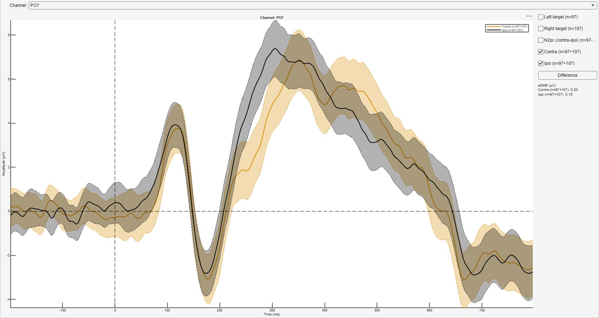

*Tools > 1. Preprocessing > Collapse Hemispheres · averaged → averaged ·
`CollapseHemispheres`*

Produces the contralateral and ipsilateral waveforms of a lateralised
component, the N2pc [@luck1994; @eimer1996] or the LRP [@coles1989],
collapsed across every pair of lateral electrodes at once. Each bin is marked
by the side of its stimulus (or the hand that responded), and two bins are
added:

$$
\text{contra} = \tfrac12\left(\bar L_{\text{right el.}} + \bar R_{\text{left el.}}\right),
\qquad
\text{ipsi} = \tfrac12\left(\bar L_{\text{left el.}} + \bar R_{\text{right el.}}\right)
$$

where $\bar L$ and $\bar R$ are the averages of the left-side and right-side
bins. Each side is averaged before the two are combined, so the sides weigh
equally however many bins each has; with one bin a side this is ERPLAB's
expression.

{#fig-collapsehemispheres-dialog}

| Option | Default | Meaning |
|------------------|------------|-------------------------------------------------------|
| **Side** of each bin | ignore | **Left**, **Right**, or **ignore**. |
| **Pair electrodes by** | auto | **geometry** (mirroring positions through the midline), **labels** (10-20 odd and even numbers, or an L/R letter), or **auto**, geometry when positions exist. |
| **Name the new bins** | Contra, Ipsi | The labels of the two added bins. |

: Collapse Hemispheres' options. {#tbl-collapsehemispheres}

The collapsed waveform of each pair is written to **both** of its electrodes,
so that the new bins have the same channels as the old ones: the Contra bin
at PO7 and at PO8 is the same contralateral waveform, scalp maps still draw,
and a measurement window defined on PO7 keeps working. Midline and unpaired
electrodes carry the plain mean of the two sides. Standard errors are
propagated as for any combination bin ([Average](https://markspan.github.io/Alakazam/#sec-tr-average)).

{#fig-collapsehemispheres-result}

The contra-minus-ipsi **difference** alone can also be had without side
assignments, by combining Derive Channels (`let C34 = C4 - C3`) with a
difference bin (`bin 3 = 0.5 bin 1 - 0.5 bin 2`), which agrees with ERPLAB
to within 10^-14^ µV. What that route cannot give is contra and ipsi
separately, or every pair at once.

**Toolbox or own code.** ERPLAB reaches the same waveforms by composing a
channel operation and a bin operation, as in Luck's `BinOps_Contra`
[@luckApplied]; Alakazam does it in one step, and agrees with ERPLAB's
result to 6.7e-15 µV.
